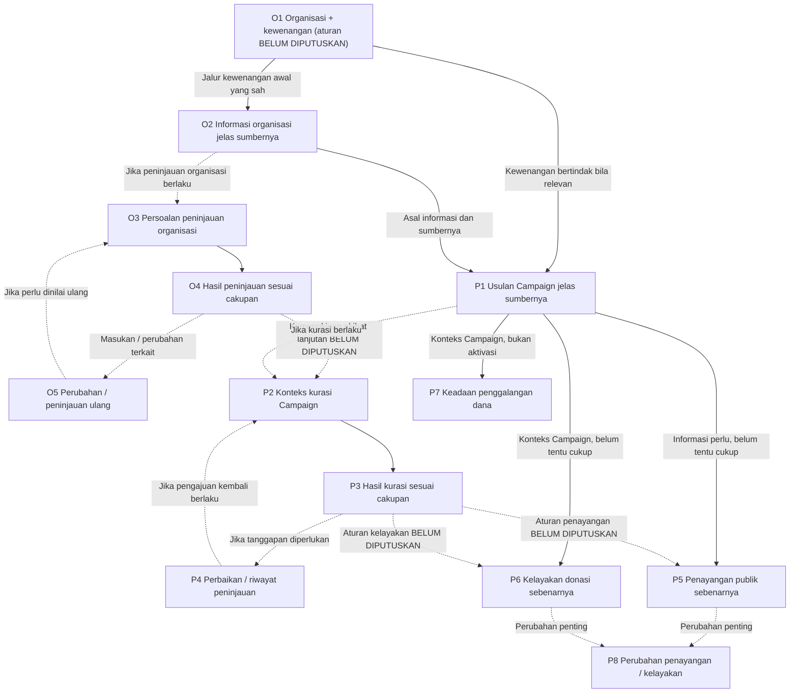
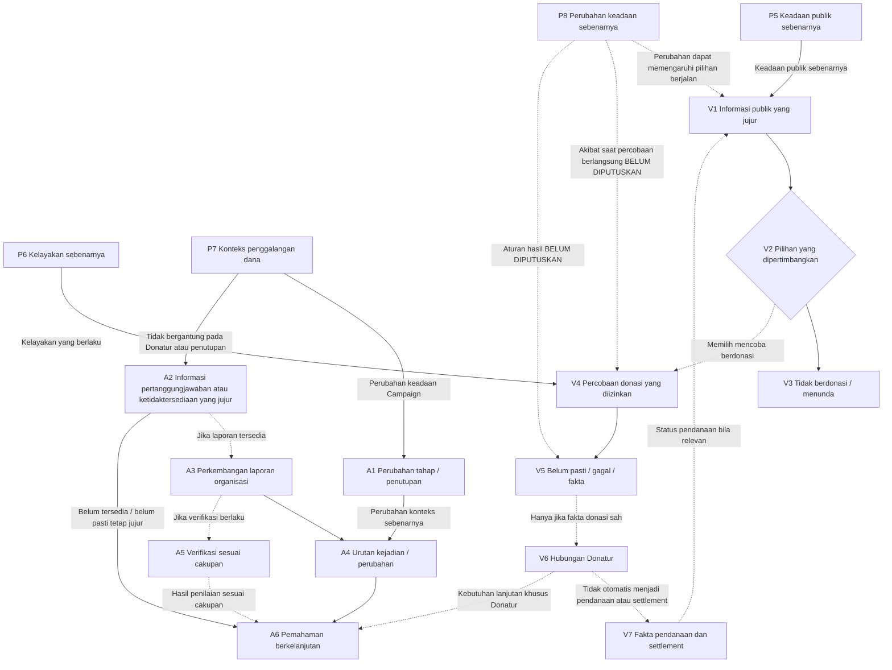

# Kencleng — Journey Level 2 (Draf Bahasa Indonesia)

> **Status:** DRAF BAHASA INDONESIA LENGKAP — **BELUM DISETUJUI DAN BELUM MENJADI SUMBER UTAMA**. Memuat 26 node, hubungan silang, diagram, EX-OPS, pemeriksaan kondisi gagal, dan keputusan Product OPEN. Masih perlu audit akhir kesetaraan makna sebelum promosi.
> **Sumber resmi:** [Level 2 v0.3](level-2-network.md), blob `4970ba936d107e50d8260c9e246816ba13d41a28`, disetujui Anhar pada 22 Oktober 2026. [Product Intent](../product-intent.md) dan [pengantar Journey](README.md) tetap berlaku menurut lingkupnya.
> **Batas:** Penyederhanaan bahasa saja. Tidak membuat aturan O1 baru, mengganti 26 kode node, mengubah hubungan antar-Journey, atau memberi izin development. Bagian yang belum ditulis ulang **wajib dibaca dari dokumen resmi**.
> **Lokasi:** Branch riset `pilot/station5-c1-space-only`; tidak mengubah Kencleng `main` atau Harscode.

## 1. Cara membaca peta

Peta Level 2 menunjukkan **perubahan yang bermakna** bagi pengguna atau keadaan Product: siapa yang bertindak, apa yang benar-benar berubah, syaratnya, dan apa yang masih belum pasti. Ini bukan daftar layar, API, fitur CRUD, urutan development, atau bukti pekerjaan sudah selesai.

### Kode kelompok Journey

| Kode | Kelompok | Kode historis |
| --- | --- | --- |
| `J-ORG` | Organisasi dan peninjauan | `R1` |
| `J-CAM` | Campaign | `R2` |
| `J-VIS` | Pengunjung dan Donatur | `R3` |
| `J-ACC` | Pertanggungjawaban | `R4` |
| `EX-OPS` | Pengecualian pengelola platform | `X1` |

`EX-OPS` berlaku lintas-Journey dan **bukan Journey kelima**.

### Arti hubungan

- **Syarat yang diperlukan:** Tanpa kondisi, informasi, atau kewenangan tertentu, hasil tidak boleh dinyatakan benar. Memenuhi satu syarat **belum tentu cukup** untuk berhasil.
- **Bersyarat:** Hubungan hanya berlaku jika kondisi terkait terpenuhi. Belum ada aturan umum **tidak berarti** sebuah kondisi boleh diabaikan untuk semua kasus.
- **Kelanjutan:** Suatu hasil memunculkan tanggung jawab atau kebutuhan berikutnya; tidak otomatis menentukan pekerjaan development selanjutnya.
- **Perubahan / peninjauan ulang:** Informasi baru dapat membuat keputusan atau informasi diperbaiki atau dinilai ulang. **Tidak setiap perubahan** mewajibkan peninjauan ulang.
- **BELUM DIPUTUSKAN:** Aturan Product belum diselesaikan. Jika diperlukan untuk hasil tertentu, keputusan harus dibuat oleh pemiliknya; jangan menebak.
- **Tidak otomatis berarti:** Dua keadaan berbeda harus tetap dibedakan, misalnya Campaign terlihat publik tidak otomatis boleh menerima donasi.

Kode `O1–O5`, `P1–P8`, `V1–V7`, dan `A1–A6` hanya penanda bagian peta, bukan urutan pelaksanaan atau persetujuan aturan Product. Peta lengkap memiliki **26 node**. Draf ini sudah memuat rincian **26 node**: lima `J-ORG`, delapan `J-CAM`, tujuh `J-VIS`, dan enam `J-ACC`. Namun, ini belum mencakup seluruh hubungan dan batas peta.

## 2. J-ORG — Organisasi dan peninjauan

| Kode | Perubahan atau hasil yang bermakna | Batasan dan keputusan yang masih terbuka |
| --- | --- | --- |
| **O1** | Seseorang hendak membentuk konteks organisasi yang jelas di Kencleng dan hubungan kewenangan **internal** yang dapat diketahui siapa pelakunya. Hasilnya harus jujur, bermakna, dan tetap tersimpan sebagai keadaan yang nyata. | **BELUM DIPUTUSKAN:** siapa yang boleh membentuk organisasi, siapa menerima peran `Owner` pertama, kapan pembentukan dan kewenangan dinyatakan sah, serta arti hasil yang belum lengkap atau dipersengketakan. Product Intent **belum menetapkan pemberian `Owner` otomatis atau keberhasilan gabungan tertentu**. O1 bukan syarat universal bagi tindakan organisasi lain. |
| **O2** | Informasi atau bukti yang diberikan organisasi mempunyai sumber organisasi yang jelas dan diketahui perwakilan yang bertindak jika relevan. | Informasi tetap **berasal dari organisasi**; bukan otomatis fakta platform, hasil peninjauan organisasi, bukti hukum eksternal, atau hasil kurasi Campaign. Informasi bisa diberikan saat atau setelah pembentukan jika kewenangan yang berlaku memungkinkan. Tidak semua pengisian informasi harus melewati O1 lebih dulu. |
| **O3** | Jika peninjauan organisasi berlaku untuk suatu persoalan, ruang lingkup peninjauan, bukti yang relevan dan asalnya, riwayat terkait, serta kewenangan peninjau harus tersedia. | Kapan peninjauan berlaku, bahan minimum, dan akibat hukumnya **BELUM DIPUTUSKAN**. Peninjau dengan `conflict of interest` terhadap perkara terkait tidak boleh menilai. |
| **O4** | Peninjau menyampaikan hasil penilaian sesuai ruang lingkup yang boleh dinilai. Jika belum bisa menilai secara sah, keterbatasan tersebut tetap dinyatakan dengan jujur. | Hasil penilaian **tidak otomatis** memberi label umum bahwa organisasi telah dapat dipercaya. Arti hasil positif, negatif, belum selesai, dan dampak pada Campaign **BELUM DIPUTUSKAN**. |
| **O5** | Perubahan penting, masukan, atau masalah yang belum selesai dapat memicu peninjauan ulang organisasi jika berlaku. | Pemicu peninjauan ulang dan kapan keputusan sebelumnya digantikan **BELUM DIPUTUSKAN**. Tidak setiap perubahan memerlukan peninjauan ulang. |

### Batas J-ORG yang harus tetap dijaga

- `Owner` dan `Staff` memiliki kewenangan berbeda. Kewenangan `Owner` tidak otomatis dimiliki `Staff`.
- Peninjauan organisasi **tidak sama dengan** kurasi Campaign; informasi dari organisasi juga bukan hasil pemeriksaan independen.
- Hubungan antara O1/O2 dan tindakan Campaign mempunyai syarat kewenangan atau informasi masing-masing; O1 tidak otomatis menjadi prasyarat seluruh Journey Campaign.
- Persetujuan atas peta **bukan persetujuan** aturan lengkap O1 atau hasil peninjauan organisasi.
- Hubungan antarnode, diagram, dan keputusan yang belum dibuat harus tetap dibaca dalam [Level 2 v0.3 resmi](level-2-network.md) sampai terjemahan lengkap diaudit dan disetujui.

## 3. J-CAM — Campaign, kurasi, dan keadaan sebenarnya

| Kode | Perubahan atau hasil yang bermakna | Batasan dan keputusan yang masih terbuka |
| --- | --- | --- |
| **P1** | Perwakilan organisasi yang berwenang memberikan usulan Campaign. Asal organisasi dan pihak yang memberikan informasi harus dapat diketahui; klaim dalam usulan tidak otomatis menjadi fakta yang dibuktikan Kencleng. | Orang yang bertindak harus benar-benar memiliki **kewenangan untuk menyampaikan usulan Campaign ini**. Tidak wajib seluruh kegiatan `J-ORG` selesai atau peninjauan organisasi telah dilakukan. Campaign berada di bawah organisasi; hak `Owner` dan `Staff` untuk tindakan spesifik ini **BELUM DIPUTUSKAN**. |
| **P2** | Jika kurasi Campaign memang berlaku, usulan masuk ke peninjauan yang mempunyai cakupan dan dasar yang jelas. | Diperlukan kewenangan peninjau, bukti terkait, riwayat yang relevan, serta larangan `conflict of interest`. Kurasi Campaign berbeda dari peninjauan organisasi. **Kurasi bukan syarat universal** untuk setiap Campaign. |
| **P3** | Hasil kurasi dalam cakupan yang berlaku, masukan perbaikan, atau keadaan ketika peninjau belum dapat memberi penilaian harus dapat dibedakan. | Hasil kurasi positif **tidak otomatis** membuat Campaign tampil publik atau boleh menerima donasi. Penolakan, informasi yang belum cukup, dan permintaan perubahan harus dapat dibedakan. Arti dan akibat tepat dari masing-masing hasil **BELUM DIPUTUSKAN**. |
| **P4** | Organisasi menanggapi masukan, memperbaiki, atau mengirim ulang informasi bila berlaku. Riwayat yang relevan harus menghubungkan perubahan dengan masukan atau hasil penilaian sebelumnya. | Kapan harus dinilai ulang, apakah penolakan bersifat akhir, kapan hasil lama digantikan, dan kapan usulan boleh diajukan kembali **BELUM DIPUTUSKAN**. **Tidak setiap perubahan** wajib dikirim ulang atau dikurasi kembali. |
| **P5** | Campaign mempunyai **keadaan penayangan publik yang sebenarnya**. Pengguna yang berhak melihatnya dapat menemukan informasi Campaign hanya ketika Campaign benar-benar sedang ditayangkan untuk mereka. | Usulan Campaign adalah **informasi yang diperlukan**, bukan izin penayangan. Syarat penayangan, kaitannya dengan kurasi, dan pencabutan penayangan akibat perubahan penting **BELUM DIPUTUSKAN**. |
| **P6** | Campaign mempunyai **keadaan kelayakan menerima donasi yang sebenarnya**, terpisah dari penayangan publik maupun hasil kurasi. | Syarat kelayakan, hubungannya dengan penayangan dan kurasi, serta aturan perubahan kelayakan **BELUM DIPUTUSKAN**. Campaign yang terlihat publik **belum tentu** boleh menerima donasi. |
| **P7** | Campaign memiliki keadaan penggalangan dana dan tahap keberlangsungannya yang benar, termasuk perubahan penting dan kemungkinan penutupan. | Keadaan ini **berbeda** dari status penayangan (P5) dan izin menerima donasi (P6). Syarat aktivasi, makna setiap tahap, serta akibat penutupan **BELUM DIPUTUSKAN**. Keadaan Campaign menjadi konteks yang diperlukan untuk pertanggungjawaban yang berlanjut. |
| **P8** | Perubahan penting pada penayangan publik atau kelayakan menerima donasi harus ditunjukkan sebagai **perubahan keadaan yang benar-benar terjadi**, beserta akibat yang relevan bagi Journey lain. | Aturan perubahan kedua status secara terpisah **BELUM DIPUTUSKAN**. Perubahan dapat memengaruhi akses Pengunjung atau percobaan donasi yang sedang berlangsung; akibat pastinya membutuhkan aturan Product sesuai kasus. **Jangan menganggap izin sebelumnya tetap berlaku setelah keadaan berubah.** |

### Batas J-CAM yang harus tetap dijaga

- Kewenangan perwakilan organisasi untuk bertindak harus nyata. Tidak seluruh tahapan `J-ORG` wajib selesai dan peninjauan organisasi tidak otomatis menjadi syarat setiap tindakan Campaign.
- **Usulan Campaign ≠ hasil kurasi ≠ penayangan publik ≠ izin menerima donasi.** Setiap hasil harus mengikuti keadaan dan aturan yang memang berlaku.
- Kurasi hanya dilakukan **jika berlaku**. Hasil kurasi positif tidak otomatis mengizinkan penayangan maupun donasi.
- Penolakan, permintaan revisi, informasi yang belum cukup, perubahan keadaan, dan peninjauan ulang bukan satu keadaan yang sama. Aturan kapan masing-masing berlaku masih terbuka.
- Jika status Campaign berubah ketika seseorang sedang mempertimbangkan atau mencoba berdonasi, **jangan menganggap kelayakan sebelumnya tetap berlaku**. Akibat tepat pada percobaan donasi masih membutuhkan keputusan Product.
- Hubungan `J-CAM` dengan `J-VIS`, `J-ACC`, serta diagram dan seluruh hubungan antarnode tetap dibaca dari [Level 2 v0.3 resmi](level-2-network.md) sampai draf lengkap ini diaudit dan disetujui.

## 4. J-VIS — Pengunjung, keputusan berdonasi, dan keadaan uang

| Kode | Perubahan atau hasil yang bermakna | Batasan dan keputusan yang masih terbuka |
| --- | --- | --- |
| **V1** | Pengunjung dapat mengakses informasi Campaign yang **benar-benar terbuka untuk publik**, termasuk organisasi yang bertanggung jawab, tujuan, asal informasi, keadaan Campaign, arti informasi pendanaan, dan hal yang belum diketahui. | Memerlukan status penayangan sebenarnya (P5) dan informasi terkait yang dapat diketahui asalnya. Hasil peninjauan dengan cakupan tertentu dapat membantu Pengunjung memahami informasi **bila berlaku**, tetapi bukan syarat universal. Pengunjung yang melihat Campaign publik **tidak harus belum memiliki akun**. |
| **V2** | Informasi yang relevan dan bisa dipahami membantu Pengunjung membuat pilihan secara sadar, tanpa tekanan untuk berdonasi. | Kencleng **tidak dapat menjamin apa yang benar-benar dipahami di dalam pikiran Pengunjung**. Informasi yang dianggap cukup bukan berarti semua informasi harus ditampilkan. Informasi penting yang wajib dijelaskan sebelum donasi masih memerlukan aturan Product sesuai cakupannya (**BELUM DIPUTUSKAN**). |
| **V3** | Pengunjung boleh **tidak berdonasi** atau **menunda keputusan**, dan keduanya tetap merupakan hasil pilihan yang wajar, bukan kegagalan Product. | Tidak otomatis perlu menyimpan catatan bahwa Pengunjung menolak atau menunda donasi. Jangan menambahkan kewajiban pencatatan atau mendorong donasi dengan tekanan. |
| **V4** | Jika Pengunjung memilih mencoba berdonasi, ia dapat memulai **percobaan donasi** hanya saat syarat kelayakan Campaign yang benar-benar berlaku mengizinkan tindakan itu. | Izin menerima donasi (P6) adalah syarat **khusus untuk percobaan donasi**, bukan syarat untuk sekadar memahami Campaign atau memilih tidak berdonasi. Jika status Campaign berubah selama percobaan, aturan penerimaan atau penolakannya **BELUM DIPUTUSKAN**. Keinginan berdonasi **bukan** bukti bahwa percobaan telah dimulai. |
| **V5** | Hasil percobaan donasi harus dinyatakan sesuai bukti yang ada: **belum selesai atau masih menunggu kepastian**, **gagal**, atau **memiliki fakta donasi yang diakui** jika fakta tersebut memang ada. | Percobaan tidak membuktikan bahwa donasi telah terjadi. Status belum pasti atau gagal **tidak boleh** ditampilkan sebagai donasi berhasil, hubungan Donatur, atau keadaan pendanaan yang sudah terwujud. Syarat tepat pengakuan donasi masih membutuhkan keputusan Product. |
| **V6** | Fakta donasi yang benar-benar diakui dan terkait dengan Campaign membentuk **hubungan Donatur dengan Campaign tersebut**. | Perbedaan Donatur yang memakai akun dan yang berdonasi sebagai tamu adalah persoalan tersendiri; rincian hak atau pengalaman keduanya **BELUM DIPUTUSKAN**. Memiliki akun atau sekadar mencoba berdonasi **tidak otomatis** menjadikan seseorang Donatur. |
| **V7** | Pengunjung dan Donatur dapat memahami keadaan uang yang **benar-benar didukung bukti**. Fakta donasi, pendanaan Campaign, dan penyelesaian transaksi uang (**settlement**) harus dibedakan. | Fakta donasi **tidak otomatis** membuktikan pendanaan atau settlement, apalagi pelaksanaan kegiatan dan dampak nyata. Pembayaran simulasi **harus disebut sebagai simulasi**, bukan sebagai uang yang benar-benar diselesaikan di luar sistem. Sumber bukti, pemicu, dan aturan tepat setiap keadaan **BELUM DIPUTUSKAN**. |

### Batas J-VIS yang harus tetap dijaga

- **Memahami Campaign ≠ memilih berdonasi ≠ memulai percobaan donasi.** Pengunjung boleh memutuskan tidak berdonasi atau menunda tanpa diperlakukan sebagai kegagalan.
- **Percobaan donasi ≠ fakta donasi yang diakui ≠ hubungan Donatur.** Keadaan belum pasti atau gagal tidak boleh dinaikkan menjadi keberhasilan.
- **Fakta donasi ≠ pendanaan Campaign ≠ settlement ≠ pelaksanaan kegiatan atau dampak nyata.** Setiap klaim hanya boleh mengikuti keadaan dan informasi yang benar-benar tersedia.
- Penayangan publik (P5) berbeda dari kelayakan menerima donasi (P6). Pengunjung tidak perlu memenuhi kelayakan donasi hanya untuk memahami Campaign atau memilih tidak berdonasi.
- Jika kelayakan Campaign berubah di tengah percobaan, jangan menganggap izin lama otomatis masih berlaku. **Aturan hasil percobaan tetap BELUM DIPUTUSKAN**, bukan ditentukan oleh draf ini.
- Hubungan berikutnya antara Donatur, pendanaan, dan pertanggungjawaban serta diagram lintas-Journey tetap mengacu pada [Level 2 v0.3 resmi](level-2-network.md) selama draf ini belum lengkap dan disetujui.

## 5. J-ACC — Keadaan Campaign dan pertanggungjawaban berkelanjutan

| Kode | Perubahan atau hasil yang bermakna | Batasan dan keputusan yang masih terbuka |
| --- | --- | --- |
| **A1** | Perubahan penting pada keadaan penggalangan dana atau penutupan Campaign mengubah konteks Campaign. Tanggung jawab untuk menjelaskan perkembangan dan hasil tetap bermakna. | **Campaign ditutup ≠ pertanggungjawaban selesai.** Pemicu penutupan dan akibat tepatnya bagi Campaign serta pihak terkait **BELUM DIPUTUSKAN**. |
| **A2** | Informasi atau laporan pertanggungjawaban organisasi yang relevan tersedia. Jika belum tersedia atau masih menunggu, keadaan itu tetap dijelaskan **sesuai kenyataannya**, bukan dinyatakan sudah lengkap. | Pertanggungjawaban dapat bermakna **sebelum Campaign ditutup dan meskipun belum ada Donatur**. Kewajiban minimum organisasi, pemicu dan waktu pelaporan, siapa yang berhak melihatnya, serta kondisi kapan laporan dianggap belum dipenuhi **BELUM DIPUTUSKAN**. Status belum tersedia tidak otomatis berarti pelanggaran. |
| **A3** | Perkembangan kegiatan atau hasil yang dilaporkan organisasi dapat diketahui sebagai **informasi yang berasal dari organisasi**, beserta pihak yang bertanggung jawab atas informasi tersebut. | **Laporan organisasi ≠ verifikasi independen ≠ dampak nyata yang terbukti.** Asal laporan dan kewenangan `Owner` atau `Staff` yang bertindak tetap dibedakan. Laporan tidak otomatis berubah menjadi fakta yang telah diverifikasi pihak lain. |
| **A4** | Jika informasi baru muncul, dikoreksi, diperselisihkan, atau berubah, urutan kejadian, asal informasi, dan ketidakpastian yang penting tetap bisa dipahami. | Ini **tidak otomatis mewajibkan penyimpanan seluruh catatan teknis mentah (audit log)** atau satu laporan akhir yang tak boleh berubah. Kapan keputusan/laporan lama digantikan dan kapan persoalan dibuka kembali **BELUM DIPUTUSKAN**. |
| **A5** | Jika verifikasi penggunaan dana oleh peninjau memang berlaku, peninjau dapat memberi **hasil verifikasi terbatas sesuai cakupan dan kewenangannya**. Jika penilaian yang sah belum bisa diberikan, keadaan itu harus tetap jelas. | Kewenangan, independensi peninjau, `conflict of interest`, bukti yang diperlukan, kapan verifikasi wajib dilakukan, dan arti hasilnya **BELUM DIPUTUSKAN**. Verifikasi terbatas **tidak otomatis membuktikan seluruh dampak nyata**. |
| **A6** | Pihak yang memang berhak mengakses informasi, yaitu publik dan/atau Donatur **sesuai aturan yang berlaku**, dapat terus memahami laporan, fakta yang diketahui, hasil peninjauan sesuai cakupannya, serta ketidakpastian yang masih ada. | Hubungan Donatur yang benar-benar ada dapat memberi kebutuhan informasi tambahan, tetapi **Donatur bukan syarat agar pertanggungjawaban organisasi bermakna**. Siapa yang berhak melihat informasi, akses tamu, dan kondisi kapan pertanggungjawaban dianggap selesai **BELUM DIPUTUSKAN**. Tidak semua laporan otomatis bersifat publik. |

### Batas J-ACC yang harus tetap dijaga

- **Penutupan Campaign ≠ selesai pertanggungjawaban.** Kewajiban dan keterbukaan informasi dapat tetap relevan sebelum maupun setelah penutupan, termasuk ketika jumlah Donatur masih nol.
- **Laporan organisasi ≠ verifikasi independen ≠ dampak nyata yang terbukti.** Asal klaim, kewenangan penulis, dan hasil peninjauan harus tetap dapat dibedakan.
- **Laporan belum tersedia ≠ otomatis terjadi pelanggaran.** Jangan menciptakan tenggat, pelanggaran, atau status selesai yang belum diputuskan Product.
- Informasi yang berubah harus mempertahankan **urutan kejadian, asal informasi, dan ketidakpastian yang penting**, tanpa menentukan bentuk audit log atau aturan penggantian laporan secara teknis.
- Verifikasi penggunaan dana hanya dilakukan **jika berlaku** dan dengan kewenangan serta independensi peninjau yang sesuai. Hasilnya terbatas pada apa yang benar-benar diperiksa.
- Akses publik, Donatur, dan tamu **tidak otomatis sama**. Hubungan Donatur bukan prasyarat adanya pertanggungjawaban organisasi.
- Hubungan `J-ACC` dengan keadaan Campaign (P7), status Donatur (V6), dan bagian lainnya masih mengacu pada [Level 2 v0.3 resmi](level-2-network.md) sampai draf lengkap beserta hubungan silangnya diaudit dan disetujui.

## 6. Hubungan antar-Journey — baca sebagai jaringan, bukan urutan development

Dua diagram ini membantu melihat hubungan antarbagian. **Panah utuh** menunjukkan keadaan atau informasi yang diperlukan, atau kelanjutan yang masuk akal di satu bagian Journey. Panah utuh **tidak** berarti keadaan di sisi asal sudah cukup untuk membuktikan keberhasilan di sisi tujuan. **Panah putus-putus** menunjukkan hubungan bersyarat, peninjauan ulang, atau aturan yang masih **BELUM DIPUTUSKAN**. Jenis hubungan yang lebih tepat dijelaskan pada daftar hubungan di bagian 7.

Diagram **tidak** membuktikan urutan implementasi wajib, hubungan sebab-akibat yang sudah diuji, atau bahwa semua syarat untuk menjalankan aplikasi sudah tersedia.

### 6.1 J-ORG ↔ J-CAM

### 6.2 J-CAM ↔ J-VIS ↔ J-ACC

### 6.3 EX-OPS — Pengecualian tindakan pengelola platform

`EX-OPS` bukan Journey kelima, prasyarat yang harus dilewati seluruh node, ataupun kewenangan untuk membuat fakta Product yang tidak didukung bukti. Intervensi khusus pengelola platform melintasi Journey lain **hanya dalam batas kewenangan yang sah dan keputusan Product yang berlaku**.

Kewenangan operasional pengelola platform **tidak otomatis** menjadi kewenangan organisasi, peninjau, verifikator penggunaan dana, atau pihak yang dapat menyatakan donasi, settlement, maupun dampak nyata. Batas kewenangan positif dan tindakan koreksi yang boleh dilakukan pengelola platform **BELUM DIPUTUSKAN**.

## 7. Hubungan penting antarnode

| Hubungan | Jenis hubungan | Kesimpulan yang **tidak boleh** ditarik |
| --- | --- | --- |
| Kewenangan perwakilan yang sah → P1 | **Syarat kewenangan / didukung peta** | Organisasi yang sudah memiliki kewenangan sah wajib mengulangi O1, atau seluruh J-ORG harus diselesaikan. |
| O2 → P1/V1 | **Syarat informasi / didukung peta** | Informasi dari organisasi otomatis telah diverifikasi independen. |
| O4 → P2/P5/P6 | **Bersyarat / BELUM DIPUTUSKAN** | Seluruh pekerjaan Campaign mensyaratkan hasil peninjauan organisasi yang selesai. |
| P1 → P2 → P3 ⇄ P4 | **Kurasi bersyarat / masukan dan perbaikan** | Semua Campaign selalu melalui kurasi atau setiap perubahan wajib ditinjau ulang. |
| P1 → P5 | **Informasi yang diperlukan, belum cukup** | Usulan Campaign otomatis mengizinkan penayangan publik. |
| P3/P4 → P5/P6 | **Bersyarat / BELUM DIPUTUSKAN** | Hasil kurasi positif otomatis mengizinkan penayangan atau donasi. |
| P5 → V1 | **Syarat keadaan nyata / didukung peta** | Campaign yang publik otomatis layak menerima donasi. |
| P6 → V4 | **Syarat khusus pada percobaan donasi / didukung peta** | Kelayakan donasi diwajibkan juga untuk melihat Campaign atau memilih tidak berdonasi. |
| P8 → V1/V4/V5 | **Bersyarat / akibat BELUM DIPUTUSKAN** | Percobaan donasi yang sedang berjalan tetap mengikuti kelayakan lama setelah keadaan berubah. |
| V1 → V2 → V3 | **Pilihan Pengunjung yang sah / didukung peta** | Tidak berdonasi adalah kegagalan Product atau wajib dicatat sebagai penolakan. |
| V4 → V5 → V6 | **Hanya fakta donasi sah membentuk Donatur / didukung peta** | Niat, percobaan, keadaan menunggu, atau gagal langsung membentuk hubungan Donatur. |
| V6 ⇢ V7 | **Tidak ada akibat uang yang otomatis / didukung peta** | Hubungan Donatur atau fakta donasi membuktikan pendanaan atau settlement. |
| P7 → A1/A2 | **Keadaan Campaign dan pertanggungjawaban / didukung peta** | Campaign harus ditutup atau memiliki Donatur dahulu sebelum pertanggungjawaban berlaku. |
| A2/A3/A4 → A6 | **Informasi berkelanjutan / didukung peta; hak akses BELUM DIPUTUSKAN** | Semua laporan otomatis publik, atau setiap laporan yang belum tersedia adalah pelanggaran. |
| A3 → A5 → A6 | **Verifikasi bersyarat / perbedaan makna didukung; penerapan BELUM DIPUTUSKAN** | Laporan otomatis membuktikan dampak terverifikasi atau semua laporan wajib diverifikasi. |
| V6 → A6 | **Kebutuhan lanjutan Donatur / didukung peta** | Pertanggungjawaban organisasi hanya bermakna jika sudah ada Donatur. |
| EX-OPS → node lain | **Pengecualian lintas-Journey, bukan syarat normal** | Pengelola platform boleh membuat fakta organisasi, hasil peninjauan, settlement, atau dampak tanpa kewenangan/bukti yang sah. |

Hubungan berstatus **BELUM DIPUTUSKAN** adalah masalah Product yang sengaja terlihat, **bukan** aturan tersembunyi yang boleh diisi berdasarkan asumsi. Panah pada diagram tidak membuktikan ketergantungan teknis yang sudah diuji dan bukan urutan wajib development.

## 8. Pemeriksaan keadaan negatif, gagal, dan belum pasti

| Kondisi yang diuji | Makna yang harus tetap dijaga |
| --- | --- |
| Pembentukan organisasi tanpa asal informasi jelas atau kewenangan internal yang belum utuh | O1 tidak boleh dinyatakan berhasil secara sah tanpa aturan keberhasilan yang disetujui khusus untuk hasil itu. Keadaan sebagian atau diperselisihkan tetap **BELUM DIPUTUSKAN**, bukan diwarisi dari aturan pilot lama. |
| Perselisihan perwakilan organisasi yang belum terselesaikan | O1 tidak boleh diam-diam dianggap membentuk organisasi tanpa sengketa; mekanisme penyelesaiannya belum ditetapkan. |
| `Staff` bertindak di luar kewenangan | O2/P1/P4/A2/A3 tidak otomatis memiliki kewenangan `Owner`. |
| Peninjau mempunyai `conflict of interest`, tidak cukup kewenangan atau bukti | O3/O4, P2/P3, dan A5 tidak boleh menghasilkan penilaian sah yang sebenarnya tidak didukung. |
| Peninjauan organisasi belum selesai, negatif, atau perlu dinilai ulang | O4/O5 tetap sesuai batas keputusannya; akibat terhadap Campaign **BELUM DIPUTUSKAN**. |
| Kurasi ditolak, diminta perbaikan, atau ada perubahan penting | P3/P4 menjaga riwayat terkait; aturan peninjauan ulang masih **BELUM DIPUTUSKAN**, bukan otomatis. |
| Campaign publik tetapi tidak boleh menerima donasi | P5 dan V1–V3 tetap bermakna; percobaan donasi V4 tidak dapat dilakukan dalam kondisi ini. |
| Status penayangan/kelayakan berubah saat Pengunjung mempertimbangkan atau mencoba donasi | P8 harus menunjukkan perubahan nyata; akibat tepat terhadap V4/V5 **BELUM DIPUTUSKAN**. |
| Pengunjung memutuskan tidak berdonasi atau menunda | V3 merupakan hasil pilihan yang sah; tidak boleh ada tekanan atau kewajiban pencatatan yang dibuat-buat. |
| Percobaan donasi masih menunggu atau gagal | V5 tidak boleh dinaikkan menjadi V6 atau memberi kesan V7 sudah terpenuhi. |
| Fakta donasi ada tanpa bukti pendanaan/settlement | V6 dan V7 berbeda; simulasi tidak boleh dianggap bukti uang nyata. |
| Informasi pendanaan terlihat oleh Pengunjung | V1 hanya boleh menampilkan keadaan, asal informasi, dan ketidakpastian yang benar-benar didukung. |
| Campaign ditutup atau dilaporkan saat belum ada Donatur | P7/A1/A2/A6 tetap bermakna sekalipun V6 tidak terjadi. |
| Laporan belum lengkap atau belum tersedia | A2/A6 harus jujur; jangan menciptakan tenggat, pelanggaran, atau status selesai yang belum diputuskan. |
| Laporan tanpa verifikasi independen | A3 berbeda dari A5; A6 tidak boleh menyebut dampak sudah terbukti. |
| Laporan atau penilaian sebelumnya berubah | A4 menjaga urutan kejadian yang penting; kapan hasil lama diganti masih **BELUM DIPUTUSKAN**. |
| Koreksi khusus pengelola platform | EX-OPS tidak boleh berpura-pura bertindak sebagai organisasi, peninjau, penyelesai transaksi, atau verifikator independen. |

**Hasil pemeriksaan peta yang sudah disetujui:** kondisi penting pada skenario perwakilan mempunyai node, hubungan, atau batas **BELUM DIPUTUSKAN** yang terlihat. Ini adalah **kelengkapan makna peta untuk riset**, bukan kelengkapan seluruh kasus produksi atau bukti pengujian sistem nyata.

## 9. Keputusan Product yang tetap BELUM DIPUTUSKAN

1. **J-ORG:** siapa mendapat kewenangan `Owner` awal dan bagaimana kewenangan itu diakui; asal informasi; arti hasil O1 yang berhasil, sebagian, atau disengketakan; arti hasil peninjauan organisasi yang positif/negatif; bahan minimum dan kewenangan `Owner`/`Staff`; akibat ke Campaign; serta kondisi peninjauan ulang.
2. **J-CAM:** arti dan akibat hasil kurasi; kapan perlu perbaikan, pengajuan ulang, peninjauan ulang, atau penggantian hasil sebelumnya; syarat penayangan publik dan kelayakan donasi; perubahan masing-masing keadaan dan akibatnya terhadap Pengunjung atau percobaan donasi.
3. **J-VIS:** informasi penting apa yang harus dijelaskan sebelum tindakan; arti percobaan yang boleh dilakukan dan fakta donasi yang diakui; status menunggu/gagal; perbedaan hubungan tamu dan pemilik akun; sumber/pemicu pendanaan atau settlement nyata; serta akibat perubahan status Campaign saat percobaan sedang berlangsung.
4. **J-ACC:** akibat penutupan Campaign; kewajiban minimum organisasi dan waktu pelaporan; siapa yang boleh mengakses laporan; kapan verifikasi berlaku, bagaimana hasilnya bermakna; kapan pertanggungjawaban dinilai selesai; serta penanganan bukti yang berubah.
5. **EX-OPS:** kewenangan positif pengelola platform dan jenis koreksi khusus yang diperbolehkan tanpa melanggar asal informasi, kewenangan pihak lain, atau kebenaran keadaan Product.

**Tidak semua keputusan OPEN di atas wajib diselesaikan sekaligus untuk membahas satu hasil Product yang terbatas.** Putuskan hanya hal yang benar-benar menentukan pekerjaan yang sedang dipilih.

## 10. Hasil riset, batas persetujuan, dan kelanjutan

- **21 Oktober 2026:** Anhar menyetujui checkpoint riset dua tingkat dan peta Level 2 v0.2.
- **22 Oktober 2026:** Anhar menyetujui koreksi kewenangan pada peta Level 2 v0.3. Kode kelompok Journey sekarang `J-ORG`, `J-CAM`, `J-VIS`, `J-ACC`, `EX-OPS`, dengan padanan historis seperti bagian 1. Kode **26 node** tetap: O1–O5, P1–P8, V1–V7, A1–A6.
- Peta ini menggantikan **sketsa chat 19 node** untuk episode riset ini, **bukan** Product Intent yang sudah disetujui atau catatan keputusan historis yang tetap memiliki lingkupnya sendiri.
- Pemeriksaan diagram sebelumnya sempat menghasilkan ilustrasi **39 hubungan usulan** dan satu komponen yang saling terhubung secara tidak berarah. Itu hanya ilustrasi dalam sesi riset, **bukan bukti kausal yang divalidasi independen**, bukan bukti semua syarat development, dan bukan kepastian aturan Product sudah lengkap.
- **Hasil checkpoint 21 Oktober:** peta cukup untuk membahas pemilihan titik awal. **Pembaruan 22 Oktober:** O1 merupakan **satu arah awal yang direkomendasikan untuk percobaan riset**, bukan prioritas delivery, kontrak Product yang disetujui, atau tugas Engineering.
- Persyaratan O1 harus dirumuskan ulang dari Product Intent dan hubungan Journey yang berlaku. **Jangan mewarisi paket persyaratan/komitmen pilot lama** sebagai aturan Product yang mengikat untuk eksperimen baru ini.
- **Batas langkah berikutnya:** selesaikan keputusan Product yang benar-benar dibutuhkan oleh O1, lalu susun kontrak Product mandiri. Jangan otomatis memilih node lain, memanggil Rancang, atau menganggap kesiapan Engineering telah terbukti. Lihat [keputusan riset tentang pemilihan titik awal dan penyerahan hasil Product](selection-and-handoff-research.md).

**Batas kewenangan draf ini:** Penulisan ulang Bahasa Indonesia bukan persetujuan baru atas aturan O1, implementasi, atau perpindahan dari research branch ke Kencleng `main`.
