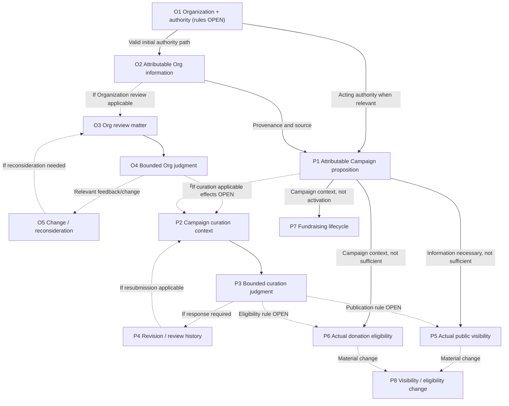
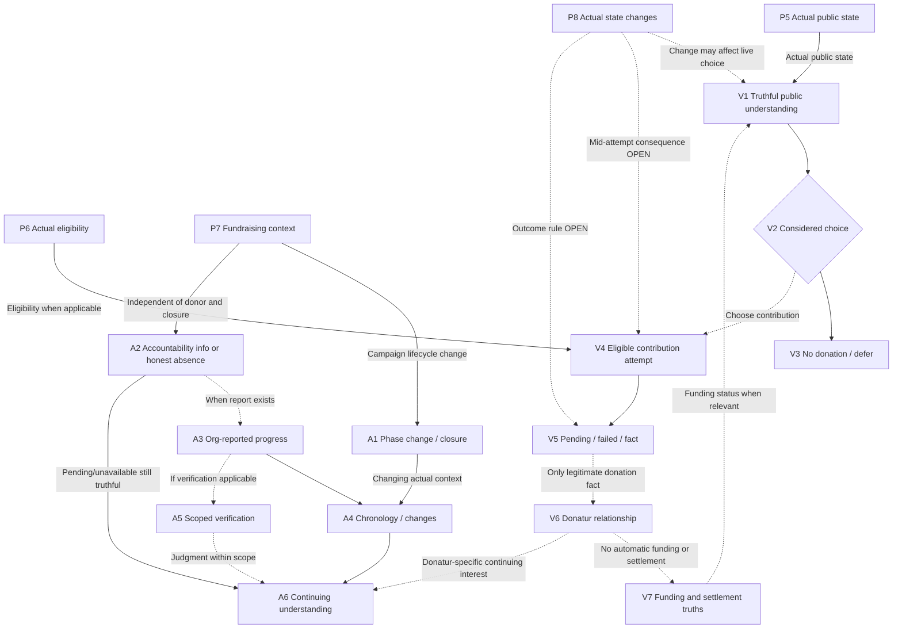

# Level 2 — Interconnected Meaningful Transition Network v0.2

> **Standing:** ANHAR-APPROVED WORKING RESEARCH MAP / official checkpoint of the Kencleng pilot Product research episode (2026-10-21); **not** operational `main` or a binding delivery roadmap.
> **Current reading order (2026-10-22):** [Product Intent](../product-intent.md) → [Current Product research entry](../README.md) → [Selection and handoff decisions](selection-and-handoff-research.md). Prior scenario/commitment artifacts are history, not current requirements authority.
> **Method boundary:** Meaningful transitions are a *network of consequences and experiences*, **not** one-to-one tasks, implementation phases, required screens, or a commitment registry.

## 1. Scope, resolution, and notation

**Level 1:** R1 Organization, R2 Campaign, R3 Public Visitor/Donation, R4 Accountability; X1 privileged Operator exception overlay. The Level 1 landscape is reconstructed in the accepted Stage 3A source.

**Level 2:** Identify specific *meaningful* transitions and what each validly changes for an actor or product state. Keep actor authority, provenance, timing, negative/unknown outcomes, and cross-journey relationships legible enough for later starting-point reasoning. **Do not infer mechanics or choose a delivery sequence from node position.**

- **Prerequisite / necessary context:** The target outcome cannot be claimed truthfully without the specified actual state/authority/information; a necessary input is **not sufficient** to cause success.
- **Conditional:** Applies only if an approved/specific condition holds; absence of a universal rule is **not proof** that the condition is optional in every case.
- **Downstream/continuity:** Creates later responsibility/interest, not necessarily the next engineering task.
- **Feedback/re-entry:** Meaningful revision, changed evidence or rejudgment. Not every edit requires this.
- **OPEN:** Product rule/relationship is intentionally unresolved and needs its owner if material to a selected path.
- **No automatic implication (`≠`):** Distinct truth classes or states must not be collapsed.

Identifier prefixes **O/P/V/A** are local diagram references only; **O1 is a research node, not a former commitment, binding Product rule set or engineering assignment**.

## 2. R1 — Organization representation and review (5 nodes)

| ID | Concrete transition / meaningful result | Guard or dependency boundary |
| --- | --- | --- |
| **O1** | A person seeks to establish an attributable Kencleng Organization context and legitimate initial **internal authority** relationship, with truthful, meaningful and durable consequence. | **RESEARCH NODE; fresh Product decisions OPEN:** who can establish, who receives initial Owner authority, when establishment and relationship become valid, and what incomplete/contested success means. Product Intent distinguishes Owner and Staff but does **not** decide automatic initial-Owner grant or a specific coupled-success rule. O1 is not a universal prerequisite for every other Organization action. |
| **O2** | Organization-provided information/evidence becomes attributable to responsible Organization and acting representative as applicable. | Information remains *Organization-provided*, not automatically Organization review, external proof, Campaign curation or platform fact. May be supplied during/after establishment within valid authority; no universal O1-first ordering of data-entry steps. |
| **O3** | An Organization matter is available for bounded review **when applicable**, with legitimate scope, attributable relevant evidence, prior context and Reviewer mandate. | Applicability, minimum material and legal consequences OPEN. COI prohibits related Reviewer judgment. |
| **O4** | Reviewer produces a legitimate scoped Organization judgment, **or** inability to judge remains explicit and truthful. | No global trusted label. Positive/negative/pending meanings and effects on Campaign are OPEN. |
| **O5** | Material changes, feedback or unresolved matters may lead to Organization review reconsideration when applicable. | Re-entry and supersession rules OPEN; not every change forces review. |

## 3. R2 — Campaign proposition, curation and actual state (8 nodes)

| ID | Concrete transition / meaningful result | Guard or dependency boundary |
| --- | --- | --- |
| **P1** | Authorized Organization representative provides an attributable Campaign proposition, with Organization source and relevant claims distinguishable. | Requires **legitimate authority for this action**, not automatic completion of every R1 activity or Organization review. Campaign belongs to Organization; exact Owner/Staff permissions OPEN. |
| **P2** | Campaign proposition enters a legitimate, bounded Campaign-curation matter **if applicable**. | Reviewer mandate, evidence, relevant history and COI boundary; Organization review is separate. |
| **P3** | Scoped curation judgment, feedback, or inability to judge becomes discernible. | Positive judgment **≠** publication **≠** donation eligibility; rejection/insufficient/requested changes are distinguishable, but exact rules OPEN. |
| **P4** | Organization responds/revises/resubmits material and relevant history links changed material with previous judgment or feedback. | Whether re-review is required, terminal rejection, supersession and allowed re-entry remain OPEN. Not every edit requires resubmission. |
| **P5** | Campaign has actual, truthful **public visibility state**; authorized audience can encounter public information when actually public. | Campaign proposition is **necessary information, not publication permission**. Publication criteria, curation relationship and material revocation OPEN. |
| **P6** | Campaign has actual, truthful **donation eligibility state**, distinguishable from visibility and curation. | Eligibility criteria, relationship to publication/curation and eligibility change rules OPEN. Do not infer public `⇒` eligible. |
| **P7** | Campaign has actual fundraising/lifecycle context, including meaningful changes and potential closure. | Not the same as P5/P6; activation, phase and closure consequences OPEN. Necessary context for substantive continuing accountability. |
| **P8** | Material public visibility or donation eligibility changes are represented as **actual changes**, including consequence for affected journeys. | Independent-change rules OPEN. Changes may affect public access or in-flight contribution and need scoped policy; avoid assuming prior eligibility persists. |

## 4. R3 — Visitor, considered decision, donation and money truth (7 nodes)

| ID | Concrete transition / meaningful result | Guard or dependency boundary |
| --- | --- | --- |
| **V1** | Visitor can access **actually public** Campaign context with relevant responsible Organization, purpose, source, actual state, funding meaning and known unknowns. | Requires P5 and relevant attributable information. An applicable bounded judgment may inform understanding, but not universally required. Public Visitor need not be unregistered. |
| **V2** | Visitor can reach a **considered, non-coercive choice** from intelligible, relevant information; Kencleng does not claim to guarantee internal understanding. | “Sufficient” is not exhaustive disclosure; required consequential information before donation remains scoped/open. |
| **V3** | Visitor chooses **no donation**, or defers consideration, without being represented as product failure. | Does not automatically require persisting a refusal/defer event. |
| **V4** | Visitor can begin legitimate contribution attempt when they choose and **actual applicable eligibility** permits. | P6 is a branch-specific prerequisite; if Campaign state changes mid-attempt, exact acceptance/rejection semantics OPEN. Choice/intention ≠ attempt. |
| **V5** | Contribution result is truthful as unresolved/pending, failed, or supported by a **legitimate donation fact** if one actually exists. | An attempt is not proof of donation; pending/failed cannot be upgraded to success, Donatur or funded state. |
| **V6** | A legitimate Campaign-specific donation fact establishes contextual **Donatur relationship**. | Guest/registered account difference is separate, capability details OPEN. Registration or attempt alone does not create Donatur status. |
| **V7** | Actual money consequences — **donation fact, funding and settlement as distinct realities** — can be truthfully understood to the extent actual signals support them. | No automatic transition from donation fact to funding or settlement, nor to execution/impact. Payment simulation is labeled simulation; source and trigger rules OPEN. |

## 5. R4 — Fundraising and continuing accountability (6 nodes)

| ID | Concrete transition / meaningful result | Guard or dependency boundary |
| --- | --- | --- |
| **A1** | Material fundraising state change or closure alters Campaign context while continuing responsibility remains meaningful. | Closure **≠** completion of accountability; exact closure trigger and consequences OPEN. |
| **A2** | Relevant Organization accountability information/report is available, **or its pending/unavailable status remains truthful**. | Accountability exists through relevant Campaign lifecycle **even with zero Donatur and before closure**. Duty, trigger, timing, audience and what constitutes missing report remain OPEN. |
| **A3** | Organization-reported progress/outcome becomes attributable reported information. | Organization report **≠** bounded independent verification **≠** proven real-world impact. Source and authorized Owner/Staff role remain distinct. |
| **A4** | New, corrected, disputed or changed information preserves material **chronology, provenance and uncertainty**. | No mandatory raw audit log or one final immutable report inferred. Supersession/reopening rules OPEN. |
| **A5** | Reviewer creates legitimate **bounded fund-use verification judgment**, if applicable, or lack of legitimate judgment remains clear. | Mandate, independence/COI, evidence, when mandatory, and judgment meaning OPEN. Not universal impact truth. |
| **A6** | Relevant authorized audience (public and/or Donatur as applicable) can continue understanding known reports, facts, scoped judgments and uncertainty. | Donatur benefits **when a legitimate relationship exists**; no donor is required to make A2/A6 meaningful. Access/guest visibility and completion criteria OPEN. |

## 6. Interconnected map — read together, not as deployment order

Solid arrows here represent a **necessary information/state condition or a coherent local progression**; they do **not** assert that the source condition is sufficient. Dashed arrows signify **conditional, feedback, or OPEN** connections. Use the edge register below to distinguish which.

### 6.1 Organization ↔ Campaign

### 6.2 Campaign ↔ Visitor/Donation ↔ Accountability

## 7. Critical typed-edge register (selection-relevant seams)

| Seam | Type / standing | What must **not** be inferred |
| --- | --- | --- |
| Valid representative authority → P1 | **Authority prerequisite / supported** | O1 must be rerun for already-valid Organizations; all R1 must be complete |
| O2 source information → P1/V1 | **Information prerequisite / supported** | Supplied Organization facts are independently verified |
| O4 → P2/P5/P6 | **OPEN / conditional** | All Campaign work requires completed Organization review |
| P1 → P2 → P3 ⇄ P4 | **Conditional review / feedback** | All campaigns universally go through curation or each edit forces re-review |
| P1 → P5 | **Necessary information, not sufficient** | Proposition automatically causes publication |
| P3/P4 → P5/P6 | **OPEN / conditional** | Positive curation automatically publishes/authorizes donation |
| P5 → V1 | **Actual-state prerequisite / supported** | Public visibility means donation eligibility |
| P6 → V4 | **Branch-specific prerequisite / supported** | Visitor understanding or choosing no donation needs eligibility |
| P8 → V1/V4/V5 | **Conditional / consequence OPEN** | In-flight contribution obeys stale prior eligibility |
| V1 → V2 → V3 | **Legitimate human outcome / supported** | Non-donation is product failure or persisted refusal |
| V4 → V5 → V6 | **Only legitimate fact creates Donatur / supported** | Intent, attempt, pending or failure create Donatur |
| V6 ⇢ V7 | **No automatic money implication / supported** | Donatur/donation fact proves funding or settlement |
| P7 → A1/A2 | **Lifecycle and accountability / supported** | Closure or donors must exist before accountability |
| A2/A3/A4 → A6 | **Information continuity / supported; audience OPEN** | Every report is public or every absent report is a breach |
| A3 → A5 → A6 | **Conditional verification / supported distinction; applicability OPEN** | Reporting = verified impact; every report requires verification |
| V6 → A6 | **Downstream Donatur interest / supported** | Donatur is prerequisite to Organization accountability |
| X1 privileged intervention → normal nodes | **Exceptional overlay, not normal prerequisite** | Operator privilege can create Organization/Reviewer/money/impact truth |

Each OPEN link is a **visible unfinished road rule**, not a hidden invented bridge. The graph is not a validated total order; diagram arrows do not constitute independently verified implementation dependencies.

## 8. Material negative, failure and uncertain-path audit

| Pressure test | Coverage and unchanged truth |
| --- | --- |
| Initial establishment lacks attribution; partial authority relation | O1 cannot claim legitimate authority result without a fresh, approved scope-specific success rule. Partial/contested conditions remain **OPEN Product decisions** rather than inherited historic requirements |
| Known unresolved representation conflict | O1 cannot silently claim uncontested establishment; conflict resolution mechanics are not invented |
| Staff action outside authority | O2/P1/P4/A2/A3 must not inherit Owner authority |
| Reviewer COI, insufficient mandate/evidence | O3/O4, P2/P3, A5 must not fabricate legitimate scoped judgment |
| Organization review pending, negative or reconsidered | O4/O5 remain bounded; Campaign consequences OPEN |
| Curation rejection/request changes/material changes | P3/P4 preserve relevant history; re-entry rules OPEN, not automatic |
| Public but donation-ineligible | P5 and V1–V3 meaningful; contribution V4 unavailable |
| Visibility/eligibility changes during consideration/attempt | P8 makes branch visible; exact V4/V5 effects OPEN |
| Visitor declines or defers | V3 is valid endpoint; no coercion or fake obligation |
| Pending/failed contribution | V5 cannot become V6 or falsely imply V7 |
| Donation fact without funding/settlement signal | V6 and V7 remain different; no simulated money claim upgrades |
| Funding state visible to visitor | V1 represents only actual supported current status/provenance/uncertainty |
| Closure or reporting with zero Donatur | P7/A1/A2/A6 remain valid independent of V6 |
| Incomplete/unavailable reporting | A2/A6 preserve actual information; no invented deadline/breach/completion |
| Reporting without independent verification | A3 ≠ A5; A6 does not claim proven impact |
| Change to older report/judgment | A4 preserves relevant chronology; supersession rules OPEN |
| Privileged Operator correction | X1 cannot impersonate Organization, Reviewer, payment/settlement or independent verifier |

**Coverage verdict:** All known representative material branches have a visible node, link, or explicit OPEN boundary. This is *semantic map completeness*, not exhaustive production test coverage.

## 9. Known OPEN Product decisions that remain surfaced

1. **R1:** fresh O1 grant, attribution, success/partial/conflict semantics; positive/negative Organization review meaning, minimum review material, relevant Owner/Staff authority, downstream Campaign effects, reconsideration triggers.
2. **R2:** bounded Campaign-curation outcomes, resubmission/re-review/supersession rules, actual publication conditions, eligibility conditions, independent state changes and affected public/contribution consequences.
3. **R3:** sufficient consequential disclosure, meaning of eligible attempt and legitimate donation fact, pending/failed result, guest/registered distinctions, real funding/settlement triggers and mid-attempt state change.
4. **R4:** closure effect, Organization's minimum duty/timing, audience boundaries, report/verification applicability, completion meaning and changed evidence.
5. **X1:** operator's positive mandate and allowed exceptional correction without crossing truth/authority boundaries.

These are **not** all mandatory preconditions to exploring one bounded starting path. Resolve only decisions that materially govern the chosen work later.

## 10. Completion, limits, and pause

**Anhar approved this Level 2 v0.2 research checkpoint on 2026-10-21.** It is a durable product-research map with **26 nodes** (O1–O5, P1–P8, V1–V7, A1–A6), representative negative paths and typed cross-journey seams. It supersedes the **chat-level 19-node sketch** for this research episode, not previously approved Product Intent or historical decision records.

A prior informal graph check counted 39 proposed links and one weakly connected component; **that count was a same-session illustration**, not a binding or independently validated causal proof. This document owns the meaningful semantic edges above; do not use connectivity counts as evidence that all Product rules, consumer readiness or delivery prerequisites have been proven.

**2026-10-21 checkpoint result:** sufficient to begin starting-point discussion. **2026-10-22 update:** O1 is a **single recommended research starting direction**, not delivery-approved or PRD-ready. Old pilot packages are **not** binding sources of O1 requirements. O1 needs fresh elaboration from current Product Intent and Level 2 context; material O1 decisions remain OPEN. See [current selection and handoff research](selection-and-handoff-research.md).

**Current next boundary:** Resolve O1's minimum consequential Product decisions and produce a standalone Product Contract without historic commitment inheritance. Do not auto-select more nodes, invoke Rancang, or infer implementation readiness. See [current working decisions](selection-and-handoff-research.md).
