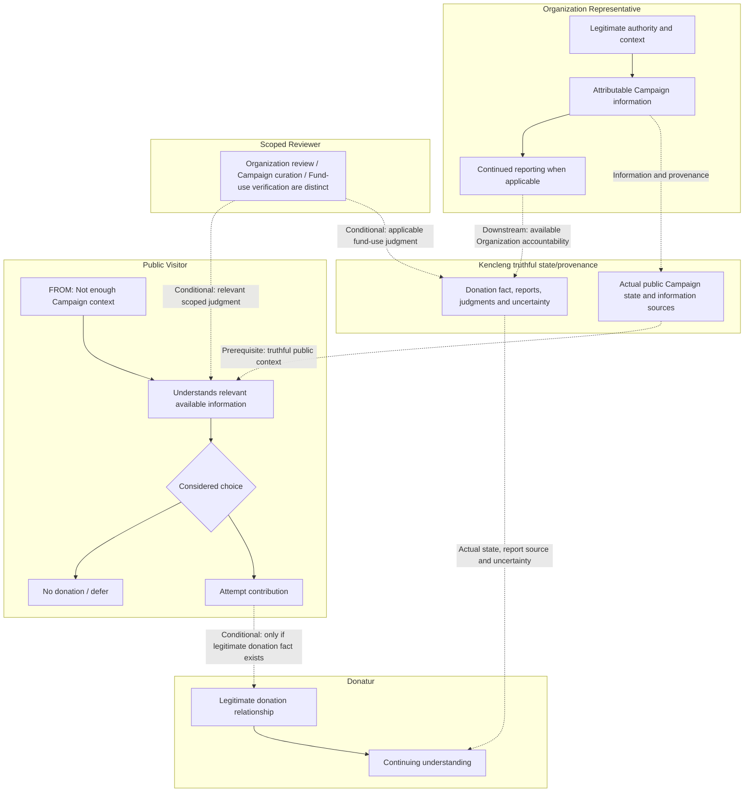

# Kencleng Pilot #3 — Actor Outcomes & Responsibilities

> **Status:** WORKING ARTIFACT — Pilot #3 Stage 2 checkpoint  
> **Human status:** Anhar-approved working state for Pilot #3  
> **Authority:** Not canonical Product Authority. Derived from current `docs/product/product-intent.md`, the Stage 1 working checkpoint, and applicable canonical Product Design authority.  
> **Working baseline:** `pilot/3-clean-delivery-baseline`  
> **Purpose:** Preserve the Stage 2 actor outcomes, responsibilities, dependencies, working decisions, and open semantics needed to enter representative-scenario discovery.

## 1. Stage 2 question and boundary

Stage 2 asks:

> **For each materially relevant actor, what outcome are they trying to achieve, what responsibility do they carry, what do they depend on, and what consequence can legitimately follow?**

This checkpoint intentionally stays above feature, screen, detailed permission, workflow, API, and implementation design.

It preserves:

- actor meaning beyond persona labels;
- desired outcomes;
- responsibilities / obligations;
- actor dependencies;
- required understanding;
- legitimate consequences;
- material authority and provenance boundaries;
- cross-actor ownership;
- open product semantics that should be resolved only when later scenarios require them.

It does **not** define:

- persona × feature matrices;
- detailed permission tables;
- exact review procedures;
- screen flows or interaction surfaces;
- account/auth implementation;
- notification design;
- operational SOPs;
- release slices;
- API/data/architecture/implementation.

## 2. Analysis approach used for this checkpoint

The following was the working discussion technique used to complete Stage 2. It is not a new canonical Kencleng methodology.

```text
1. Start from actors explicitly supported by current Product Authority
   ↓
2. Challenge actor boundaries
   - human actor vs domain entity
   - business role vs account state
   - operational privilege vs semantic authority
   ↓
3. For each actor discuss:
   - desired outcome
   - responsibility / obligation
   - dependency
   - required understanding
   - legitimate consequence
   - open semantics
   ↓
4. Challenge premature feature/permission framing
   - capability ≠ feature
   - authority ≠ CRUD access
   - account status ≠ business role
   ↓
5. Discuss actors one by one
   Public Visitor
   → Donatur
   → Organization Owner
   → Organization Staff
   → Reviewer
   → Platform Operator
   ↓
6. Run a cross-actor audit
   - overlap
   - responsibility gap
   - dependency gap
   - missing actor
   - contradiction
   ↓
7. Resolve only gaps that would distort representative scenarios
   - Owner vs Staff responsibility meaning
   - post-donation accountability ownership
   - Reviewer history requirement
   - Platform Operator semantic boundary
   ↓
8. Leave detailed permissions / workflow mechanics OPEN or PARKED
   ↓
9. Audit Stage 2 exit criteria
   ↓
10. Decide GO / NO-GO for Stage 3
```

A recurring discipline used in discussion was **challenge first, then commit**: first test whether a proposed actor meaning silently creates unsupported authority or workflow assumptions; only then keep it as a working decision.

## 3. Actor map

The materially relevant human actors for this checkpoint are:

```text
Public Visitor
Donatur

Organization Representative
├── Owner
└── Staff

Reviewer

Platform Operator
```

Important boundaries:

- Organization and Campaign are domain entities/context, not actors.
- Kencleng Product/System is an obligation layer, not a human actor.
- Public Visitor and Donatur are different business roles.
- Donatur status does not require account registration.
- Platform Operator privilege does not equal Reviewer authority or Organization authority.

## 4. Actor outcomes and responsibilities

### 4.1 Public Visitor

**Desired outcome**

Understand a public Campaign well enough to make a considered, non-coercive decision about whether to contribute.

**Responsibility / obligation**

No material business obligation is imposed merely because someone is a visitor.

**Dependency**

Depends on Organization-provided information, bounded review outcomes, and Kencleng preserving actual state, provenance, uncertainty, and consequential meaning.

**Required understanding**

At minimum, enough context to understand:

- who stewards the Campaign;
- purpose and relevant Campaign context;
- actual product state;
- relevant funding meaning;
- provenance of important claims;
- uncertainty, pending, or unavailable information;
- consequence of contributing.

**Legitimate consequence**

```text
considered decision
├─ no contribution
│  → valid product outcome
└─ contribution
   → a legitimate donation fact may exist
   → person becomes Donatur in that Campaign context
```

**Important boundary**

```text
Public Visitor
≠ unregistered user
```

A registered person who has not donated to a Campaign can still be a Public Visitor in that Campaign context.

---

### 4.2 Donatur

**Desired outcome**

Continue understanding what happened after contribution, without funding, execution, reporting, verification, and impact being collapsed into one claim.

**Responsibility / obligation**

No material ongoing obligation is established merely by becoming a Donatur.

**Dependency**

Depends primarily on substantive Organization accountability, applicable bounded review/verification, and Kencleng preserving chronology, provenance, actual state, and uncertainty.

**Required understanding**

May need to understand:

- their donation relationship to the Campaign;
- relevant donation fact;
- relevant funding state;
- operational progress where known;
- Organization reports;
- verification status when applicable;
- pending / unknown information;
- the boundary between reported outcome, verified outcome, and real-world impact.

**Legitimate consequence**

A legitimate donation relationship makes the person a Donatur in the Campaign context and creates continuing accountability dependency.

**Important boundaries**

```text
Donatur
= business role based on donation relationship

Registered user
= account relationship

Donatur
≠ necessarily registered user

Registered user
≠ automatically Donatur
```

Guest Donatur and registered Donatur are both Donatur. Their exact capability differences remain OPEN.

---

### 4.3 Organization Representative

Organization Representative is an umbrella business role used to express responsibilities shared by Owner and Staff.

**Common responsibility**

Represent the Organization truthfully within legitimate authority and provide/maintain Organization-provided Campaign and accountability information.

Typical responsibility domains include, at product-meaning level:

- Organization context;
- Campaign proposition and relevant Campaign information;
- response to review / curation;
- post-campaign reporting and accountability.

**Important provenance boundary**

```text
Organization-provided information
≠ platform-known fact
≠ Reviewer judgment
≠ independent verification
```

Business accountability for Organization-provided information primarily attaches to the Organization, while acting-representative provenance may remain materially relevant.

---

### 4.4 Organization Owner

**Desired outcome**

Enable the Organization to act through legitimate Organization-level authority on consequential matters.

**Responsibility / obligation**

Hold and exercise materially distinct Organization-level authority.

**Dependency**

Staff and downstream Organization participation depend on authority boundaries being legitimate and understandable.

**Required understanding**

Needs to understand:

- Organization state;
- relevant Campaign context;
- consequential Organization-level decisions;
- current review/curation/accountability state where relevant;
- boundary between Owner authority and Staff authority.

**Legitimate consequence**

Owner action may legitimately change Organization/Campaign state only where that action is within Owner authority. Owner action does not automatically create review, curation, public visibility, donation eligibility, verification, or impact truth.

**Working meaning**

> Owner is an **authority-bearing Organization representative**, not automatically a universal approver or Organization superuser.

---

### 4.5 Organization Staff

**Desired outcome**

Carry out meaningful Organization operational responsibilities within bounded authority.

**Responsibility / obligation**

Execute Organization work that can legitimately be performed within Staff authority.

**Dependency**

Campaign preparation, review response, ongoing information maintenance, and post-campaign accountability may depend on Staff work.

**Required understanding**

Needs to understand:

- which Organization they represent;
- relevant Campaign context and current state;
- provenance of information they provide;
- what remains unknown/pending;
- their authority boundary;
- when another actor such as Owner or Reviewer is required.

**Legitimate consequence**

Staff actions can change Organization-provided information or state only within legitimate authority. Staff action does not automatically become Reviewer judgment or independent verification.

**Working meaning**

> Staff is a **bounded operational Organization representative**, not merely an Owner with fewer buttons.

---

### 4.6 Reviewer

Reviewer is a bounded independent-judgment role. Current Product Authority distinguishes at least these decision contexts:

```text
Organization review
≠ Campaign curation
≠ fund-usage verification
```

The same human may or may not be eligible to act in multiple contexts; that is not settled here.

**Desired outcome**

Produce a legitimate, bounded review/curation/verification outcome that is understandable within its actual scope.

**Responsibility / obligation**

- judge only within the relevant mandate/scope;
- use available evidence without manufacturing certainty;
- preserve independence;
- not review relevant work when conflict of interest exists;
- produce an outcome whose meaning does not exceed what was actually reviewed.

**Required understanding**

Reviewer needs to understand:

- what is being reviewed;
- current evidence and provenance;
- applicable review scope;
- uncertainty / incomplete evidence;
- relevant prior review outcomes;
- prior feedback or requested changes;
- material changes since prior judgment;
- unresolved matters;
- conflict-of-interest context.

**Working decision — relevant review history**

> Reviewer needs **bounded relevant review history**, not merely the latest snapshot and not necessarily a raw activity log.

Relevant history must be sufficient to reconstruct, where applicable:

```text
prior judgment
→ feedback / request
→ relevant change
→ unresolved matter
→ current submission
```

This supports chronology and provenance without requiring every internal edit or system event to be part of Reviewer-facing history.

**Legitimate consequence**

A Reviewer outcome can change bounded product meaning/state only within the scope of that review. It does not automatically create downstream meaning in another review domain.

**Important boundary**

```text
Reviewer creates a bounded judgment about evidence.
Reviewer does not create universal truth or a universal trust badge.
```

---

### 4.7 Platform Operator

**Desired outcome**

Not fully established by current Product Authority. Platform Operator is explicitly an actor, but detailed positive operational responsibilities remain intentionally open.

**Responsibility / obligation — minimum working boundary**

Act only within bounded platform authority and never use elevated access to create unsupported business truth.

**Required understanding**

Where privileged intervention occurs, the operator must understand:

- current state;
- relevant provenance;
- authority boundary;
- consequence of intervention;
- whether the action is an operational intervention or a business judgment;
- whether another actor must provide the legitimate decision.

**Legitimate consequence**

A Platform Operator may have elevated operational capability, but elevated privilege does not make an intervention a legitimate Organization assertion, Reviewer judgment, donation/funding fact, verification, settlement, or impact claim.

**Working meaning**

> Platform Operator is a **privileged but bounded operational actor**. Operational privilege is not semantic authority.

Candidate responsibilities such as recovery, support intervention, moderation, or exceptional-state handling remain HYPOTHESIS until a representative scenario requires them.

## 5. Cross-actor working decisions

### 5.1 Business role vs account relationship

```text
Public Visitor / Donatur
= business role in Campaign context

guest / registered
= account relationship
```

Therefore:

- a guest may become Donatur;
- a registered person may still be Public Visitor for a Campaign they have not donated to;
- account registration does not define donation relationship.

### 5.2 Organization Representative vs Owner vs Staff

Working division:

| Layer | Product meaning |
| --- | --- |
| Organization Representative | Represents Organization truthfully and carries Organization responsibilities |
| Owner | Authority-bearing representative for consequential Organization-level authority |
| Staff | Bounded operational representative |

Exact permissions remain OPEN.

### 5.3 Authority, provenance, judgment, and accountability are distinct

```text
authority to act
≠ provenance of information
≠ independent judgment
≠ business accountability
```

An actor may be allowed to perform an action without that action acquiring Reviewer or platform-known meaning.

### 5.4 Reviewer authority vs Platform Operator privilege

```text
Reviewer authority
= bounded judgment authority

Platform Operator privilege
= bounded operational authority
```

Even if one human someday holds multiple roles, the provenance and meaning of each action must remain distinct.

### 5.5 Reviewer history

Reviewer needs enough relevant history to understand prior judgments, requested changes, material updates, unresolved matters, and the current object under review.

The product requirement is **reconstructable review meaning and chronology**, not a specific timeline UI, diff UI, thread UI, or raw audit-log surface.

### 5.6 Post-donation accountability ownership

Working ownership model:

```text
Organization
→ primary substantive source of post-donation / post-campaign accountability

Organization Owner / Staff
→ fulfill Organization accountability responsibilities
  within their authority

Reviewer
→ bounded independent judgment / verification when applicable

Kencleng Product/System
→ preserve chronology, provenance, state meaning,
  uncertainty, and reported ≠ verified distinctions

Platform Operator
→ bounded operational intervention,
  not creator of accountability truth

Donatur
→ primary beneficiary of continuing accountability
```

Working decision:

> Primary substantive post-donation accountability comes from the Organization; Reviewer contributes bounded independent judgment when applicable; Kencleng keeps that accountability legible, chronological, provenance-aware, and non-misleading.

No assumption is made here that every accountability item is public, donor-specific, verified, or subject to a fixed deadline.

### 5.7 Incomplete accountability is not automatically success or failure

```text
no report / incomplete information
≠ assume success
≠ assume failure
```

The product must be able to preserve honest states such as pending, incomplete, unknown, or unavailable when that is the actual truth.

Terms such as “overdue” or “breached obligation” require a separately established obligation/timing rule.

## 6. Cross-actor dependency model

```text
Organization Representatives
        │
        │ assertions / evidence / reporting
        ▼
      Reviewer
        │
        │ bounded judgment when applicable
        ▼
 Kencleng Product/System
        │
        │ preserve provenance, chronology,
        │ actual state, uncertainty, meaning
        ▼
   Public Visitor
        │
        │ considered decision
        ▼
  no donation / donation
                    │
                    ▼
                  Donatur
                    │
                    ▼
        continuing accountability
                    ▲
                    │
       Organization reporting
       + Reviewer verification
         when applicable
```

Platform Operator surrounds the flow as a bounded privileged operational actor; it is not the default source of product truth.

## 7. Finding classification

### CANONICAL / SETTLED AUTHORITY carried into this checkpoint

- Product serves public visitors/donors, Organization representatives, reviewers, and platform operators.
- Visitor may understand a public Campaign without sign-in.
- Guest contribution may be permitted when applicable rules allow.
- Organization Owners and Staff have meaningfully different authority.
- Organization review, Campaign curation, and later fund-usage verification are separate decisions.
- Reviewer must not review relevant work when conflict of interest exists.
- Trust classes, provenance, state, report, and uncertainty must remain distinguishable.
- Public visibility and donation eligibility depend on actual Campaign state.
- Funding progress is not proof of execution or impact.
- Accountability continues after contribution.
- Unknown/pending are legitimate product states.
- Simulation must not be presented as real settlement, independent verification, or impact.

### WORKING DECISIONS — Pilot #3

- Use **Donatur** for the person-role created by a donation relationship.
- Donatur is a business role, not an account-registration state.
- Organization Representative is a useful umbrella for shared Owner/Staff responsibilities.
- Owner is an authority-bearing Organization representative.
- Staff is a bounded operational Organization representative.
- Business accountability for Organization-provided information primarily attaches to the Organization; acting-representative provenance may remain relevant.
- Reviewer is a bounded independent-judgment actor.
- Reviewer requires bounded relevant review history, not merely latest snapshot.
- Platform Operator is privileged but bounded; elevated access does not create semantic authority.
- Primary substantive post-donation accountability comes from the Organization.
- Reviewer adds bounded independent judgment when applicable.
- Kencleng Product/System must preserve ordered truth rather than relying on Platform Operator intervention to manufacture correctness.
- Donatur is the primary beneficiary of continuing accountability.

### HYPOTHESIS / CANDIDATE RESPONSIBILITY

- Platform Operator may eventually own recovery, support, moderation, or exceptional-state intervention responsibilities.
- Staff is likely able to perform substantial Campaign/reporting work without Owner involvement, but exact scope is not yet established.
- Owner may govern delegation/representation authority, but exact delegation semantics are not established.

## 8. OPEN PRODUCT DECISION — carry forward

Resolve only when representative scenarios or later interaction work makes them material:

1. What does a successful / unsuccessful Organization review positively mean?
2. What does Campaign curation positively mean?
3. What is the exact relationship among curation, public visibility, and donation eligibility?
4. When and how does a donation fact legitimately produce a funding consequence?
5. What exact actions/responsibilities are Owner-only?
6. What exact actions/responsibilities can Staff perform without Owner-level authority?
7. What is the minimum post-donation / post-campaign accountability obligation?
8. When does that accountability responsibility begin and end?
9. Is any reporting deadline required?
10. Which accountability information is public vs Donatur-specific vs otherwise visibility-bounded?
11. When is verification mandatory vs optional?
12. When is accountability complete, pending, incomplete, or unmet?
13. What exactly changes when a Campaign reaches closure?
14. What positive operational responsibilities does Platform Operator own?
15. What intervention/correction powers may Platform Operator exercise without creating unsupported business truth?
16. What counts as a material change for Reviewer re-evaluation?
17. What are the product semantics of reject, re-submit, re-review, superseded outcome, or renewed review cycle?
18. What exact account/capability differences exist between guest Donatur and registered Donatur?

## 9. PARKED — NOT NEEDED YET

- detailed Owner/Staff permission matrix;
- detailed reviewer assignment mechanics;
- detailed review checklist;
- detailed conflict-of-interest detection mechanics;
- exact account/authentication model;
- UI for review history;
- timeline/diff/thread presentation;
- notification channels;
- exact reporting cadence;
- admin CRUD surfaces;
- operator tooling;
- release scope;
- delivery sequencing;
- API/data/technical architecture/implementation.

## 10. Stage 2 exit audit

| Exit criterion | Result |
| --- | --- |
| Actors are more than persona labels | PASS |
| Desired outcome and responsibility are distinguishable | PASS |
| Cross-actor dependencies are visible | PASS |
| Major authority / ownership ambiguities are surfaced | PASS |
| Owner vs Staff business meaning is differentiated enough for scenarios | PASS |
| Reviewer meaning and independence boundary are sufficiently clear | PASS |
| Relevant Reviewer history need is explicit | PASS |
| Post-donation accountability has coarse ownership | PASS |
| Platform Operator does not silently absorb product/reviewer authority | PASS |
| No material missing human actor is currently evident | PASS |
| Representative scenarios can now be formed without persona × feature decomposition | PASS |

## 11. Stage 2 verdict

**Stage 2 — Actor Outcomes & Responsibilities: COMPLETE for Pilot #3 progression.**

There is no known product-level blocker requiring Stage 2 to remain open before representative-scenario discovery.

The next active stage is:

> **Stage 3 — Product Hypothesis + Representative Scenarios**

Stage 3 should use scenarios as pressure tests to resolve only those OPEN product semantics that become necessary for a coherent end-to-end behavior.

The discussion should not return to Stage 2 merely to make the actor model exhaustive. Reopen a Stage 2 decision only if materially new scenario evidence reveals a contradiction, missing actor, or responsibility ownership problem.

## 12. 2026-10-21 Experience-first Stage 2 reconstruction checkpoint

> **Standing:** **Anhar-approved working reconstruction v0.2**, Kencleng Pilot #3 only. Experimentally sufficient to explore Stage 3; **not** new canonical Product Authority, MVP scope, C1 amendment, engineering assignment or operational runtime evidence.
> **Approval:** Anhar approved the Stage 2 reconstruction and repository persistence on 2026-10-21.
> **Source hierarchy:** [Pilot Product Intent](product-intent.md), [Stage 1 approved value story](pilot-3-business-value-loop.md#9-2026-10-21-experience-first-stage-1-reconstruction-checkpoint), and applicable [Product Design Principles](../ui-ux/product-design-principles.md) in their own design scope. Historical Stage 2 (sections 1–11) is preserved as historical pilot research/working decisions; this reconstruction does **not** automatically supersede C1-specific approvals.
> **Experiment:** [Harscode Interconnected Journey Blueprint Research v0](https://github.com/anhsbolic/harscode-workspace/blob/74e6fcd45ad52ea3a66960712131b7fa209b836d/product/interconnected-journey-blueprint-research.md) is an optional visualization technique, not a required methodology.
> **Branch boundary:** This is `pilot/station5-c1-space-only`, **not** Kencleng operational `main`; current Kencleng `main` authority and delivery scope are unchanged.

### 12.1 One value anchor; actor situation is not motivation

Stage 1 value remains the anchor: evidence-aware, non-coercive Campaign understanding can lead to a considered decision, and a legitimate contribution creates a relationship whose **continuing understanding** matters after fundraising. The Organization provides attributable information and substantive accountability. Reviewer judgments are bounded. The product preserves actual state, chronology, provenance and uncertainty.

**FROM** means the actor's relevant current situation, not a universal feature entrypoint or asserted psychological motive. **TO** means intended legitimate value, not guaranteed emotion, verified user demand or delivered software. Alternate motivations—wishing to help, checking a claim, being cautious—are **representative hypotheses**, not field research. The same actor may enter from multiple situations.

### 12.2 Actor-specific FROM → TO and responsibility boundaries

| Actor / responsibility | FROM — representative initial situation | TO — meaningful outcome | Responsibility / standing |
| --- | --- | --- | --- |
| **Public Visitor** | Encounters an actually public Campaign but lacks sufficient context for a considered decision | Can understand relevant steward, purpose, actual state, claims/provenance, uncertainty and monetary consequences; chooses to contribute **or not** without coercion | No duty merely from viewing; information-seeking without intent to donate is valid. Deferring a decision is a plausible **experience hypothesis**, not a required persisted event. |
| **Organization Representative** (Owner/Staff umbrella) | May be new to Kencleng, may have an established Organization preparing Campaign information, or may owe continuing reporting | Can legitimately represent Organization context, communicate Campaign information and fulfill accountability within actual authority | Organization is the substantive source of its own assertions/reports. They do **not** become platform-known facts, Reviewer judgment or independent verification. |
| **Organization Owner** | A consequential Organization action requires established Organization-level authority | Can carry out a specifically authorized Organization-level action | Not a universal approver; what is Owner-only or required during initial establishment is still OPEN. |
| **Organization Staff** | An Organization task needs legitimate bounded execution | Can carry out authorized operational work for the Organization | Not just an Owner with fewer buttons; a fresh Owner approval for every Staff act is **not** established. Exact permission semantics OPEN. |
| **Reviewer** | A specific Organization, Campaign or fund-use matter requires independent scoped judgment; evidence/history, mandate and COI are relevant | Produces an attributable, bounded, understandable judgment **when legitimate**, or honestly cannot yet do so | Organization review **≠** Campaign curation **≠** fund-usage verification; reviewer COI prohibited for relevant work; neither review nor curation automatically grants publication, donation eligibility or universal trust. |
| **Donatur** | A **legitimate donation fact** already exists for a Campaign, but later facts or reports may remain unknown | Can keep understanding what really happened, what Organization reported, what was judged/verified when applicable, and what remains pending | Donatur is a role in the Campaign relationship, not necessarily an account holder; merely being Donatur does not establish a new ongoing obligation for the person. |
| **Platform Operator** | Specific positive operational intervention context has **not** been established | No detailed positive outcome selected at this stage; only bounded, legitimate intervention if later authorized | Operator privilege cannot manufacture Organization assertions, Reviewer judgments, donation/funding facts, independent verification, settlement or impact. |
| **Kencleng/System** (non-human obligation) | Distinct assertions, judgments and events need truthful representation | Preserves meaningful actual states, provenance, chronology, monetary consequences and uncertainty | Neither an omniscient actor nor implementation architecture. |

**Crucial role distinction:** Public Visitor is **not** synonymous with unregistered person; a person can be a Donatur for Campaign A and a Public Visitor for Campaign B. A contribution attempt alone does **not** make a Donatur; only a legitimate donation fact creates the relevant relationship, and that fact does not automatically create a funding consequence.

**Organization entry distinction:** A single forced `registration → initial Owner → Campaign` journey is **not** inferred from the above. Material Organization authority must be valid, but its establishment mechanism and the prerequisites of Campaign actions are separate scoped questions.

### 12.3 Follow the value backward: Public Visitor ↔ Organization

Visitor's needed experience: intelligible Campaign purpose, identifiable responsible Organization, relevant actual Campaign state, sources of claims, uncertainty, and consequences of a possible contribution.

The Organization side supplies attributable context and information through representatives acting within actual authority; Kencleng preserves what is Organization-sourced versus platform-known and what is actually public or donation-eligible.

**Tested interpretation:** A visitor depends on particular *information and legitimate actual states*, **not automatically completion of the entire Organization actor journey**. Organization review is a distinct bounded judgment and is not presumed a universal precondition for *understanding*. Conversely, this does not establish it as optional for every publication/eligibility rule. No search, recommendation or discovery feature is selected here.

### 12.4 Reviewer: scoped and conditional, not one universal gate

- **Organization review:** scoped judgment about Organization context; positive consequence and its effect on other processes OPEN.
- **Campaign curation:** scoped judgment about Campaign proposition; **not automatically** publication or donation eligibility.
- **Fund-usage verification:** scoped judgment about relevant use/report evidence; **not** universal real-world impact proof.

Reviewer must understand applicable mandate, evidence/provenance, relevant prior judgments/feedback/changes, material uncertainty and conflict-of-interest context. Insufficient authority or evidence cannot be presented as successful review. An applicable judgment may trigger Organization feedback/re-entry, inform Visitor understanding, or contribute to Donatur understanding **subject to scope and visibility**. None of these relationships is automatically mandatory for every Campaign.

### 12.5 Follow the value forward: Donatur ↔ Organization accountability

A legitimate donation relationship changes the person's contextual role and creates an ongoing interest in what happened afterward. Organization is the **primary substantive source** of its own accountability; Owner/Staff act within their bounds, Reviewer adds relevant independent judgment when applicable, and Kencleng preserves chronology, source and actual uncertainty.

**Separate semantics:** donation fact **≠** automatic funding/settlement **≠** execution **≠** reported outcome **≠** bounded verification **≠** proven real-world impact. This is a list of non-equivalences, **not** a required event sequence. Fundraising closure **≠** accountability closure.

Missing, pending, changed, delayed or unverified reporting is not automatically success, failure, "overdue", or breach. Minimum Organization reporting duties, deadlines, completion criteria, audience (public vs donor-specific), mandatory verification and guest access remain **OPEN**. The approved [Evidence Journal UX pattern](../ui-ux/patterns.md#8-evidence-journal) guides expression without establishing a Product feature/engineering commitment at this stage.

### 12.6 Cross-actor interconnections — candidate edges for Stage 3 validation

| Specific needed state/outcome → dependent outcome | Preliminary type | Confidence and boundary |
| --- | --- | --- |
| Attributable Organization/Campaign information → Visitor understanding | **Information/semantic prerequisite** | Product-intent-aligned; exact minimum disclosure OPEN; Organization claims are not independent proof. |
| Actual public Campaign state → truthful public access and status understanding | **State prerequisite** | Authority-supported; review/curation does not automatically create visibility. |
| Legitimate representative authority → Organization-provided action | **Authority prerequisite** | Supported role boundary; exact Owner/Staff authorization OPEN. |
| Scoped Reviewer judgment → Visitor interpretation or Organization follow-up | **Conditional / feedback** | Only if relevant and accessible; **not** a universal prerequisite for visitor understanding. |
| Legitimate donation fact → contextual Donatur role | **Semantic prerequisite** | Supported; guest/registered account distinction separate; attempt is insufficient. |
| Organization report / real developments → Donatur continuing understanding | **Downstream, conditionally available information** | Accountability continues; exact obligation, cadence, visibility OPEN. |
| Scoped fund-usage judgment → Donatur verified-status understanding | **Conditional** | Judgment remains bounded; verification **not** impact. |
| Campaign fundraising closure → continued post-campaign accountability | **Downstream continuity** | Closure does not settle accountability. |
| Platform Operator intervention → normal business value | **Not established as required** | No new operator workflow inferred. |

The edge types are **working research classifications**, not confirmed deployment order or a guarantee every upstream capability exists. Distinguish **needed semantic state** from **entire upstream journey**, and distinguish cross-actor prerequisites from mere adjacency.

### 12.7 Small connected Blueprint view (replaceable visualization)

Solid links express local meaningful progression; dashed labeled links express working cross-actor relationships. Diagram is **illustrative**, not a UI flow, mandatory whole-product path or Business Rule contract.



The example does not establish Organization review before Campaign preparation, curation causing public visibility, public visibility causing donation eligibility, or all reports requiring review. The Platform Operator is excluded from normal flow rather than fictionalized as a dependency.

### 12.8 Stage 2 acceptance, remaining uncertainty and next experiment

| Exit criterion | Human-approved reconstruction assessment |
| --- | --- |
| Stage 1 From → To value remains the story anchor | **PASS** |
| Visitor situations, decision agency and legitimate non-donation stay visible | **PASS** |
| Representative/Owner/Staff outcomes and bounded responsibility are distinguishable | **PASS** |
| Three Reviewer scopes, independence, provenance and relevant history are respected | **PASS** |
| Donatur continuing understanding and Organization accountability ownership are coherent | **PASS** |
| Main cross-actor dependency candidates are typed without inventing universal gates | **PASS for Stage 2; actual dependency validity remains a Stage 3 test** |
| Platform Operator positive responsibilities not fabricated | **PASS — explicitly open** |
| Detailed rules, permissions, complete scenario coverage or commitment boundaries selected | **NOT REQUIRED AT STAGE 2** |

**Stage 2 working verdict: ACCEPTED by Anhar on 2026-10-21, sufficient to proceed to Stage 3 representative interconnected journey pressure tests.** Historical conclusions in sections 1–11 remain historical pilot evidence. Reopen substantive accepted meaning only on material new evidence.

**Stage 3 focus:** Validate real prerequisite/conditional/downstream links, legitimate state transitions, authority handoffs, exception/negative/unknown paths, and meaningful, bounded candidate commitments. Historical Stage 3A/3B and C1 are comparison evidence, not automatically validated or superseded.

**Harscode checkpoint #2 (provisional research observation):** Differentiating actor `FROM → TO` from motivations, and typing interconnections, **appeared** to help prevent misleading visual dependency chains (e.g., treating Reviewer as a universal gate, full Organization establishment as every public-understanding prerequisite, or reporting as a fixed workflow). Most underlying semantic safeguards already existed historically. **No demonstrated improvement yet** in commitment selection, independent consumer comprehension or Rancang suitability. **No reusable Harscode methodology change is justified yet**; experimental Blueprint remains optional and replaceable.

**Unverified:** Real user research, product runtime behavior, consumer cold-read, solution handoff effectiveness or independent execution evidence.
